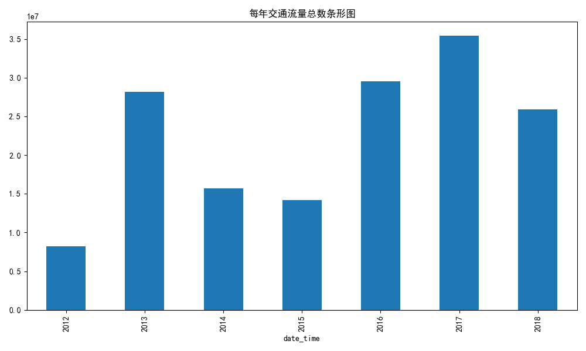
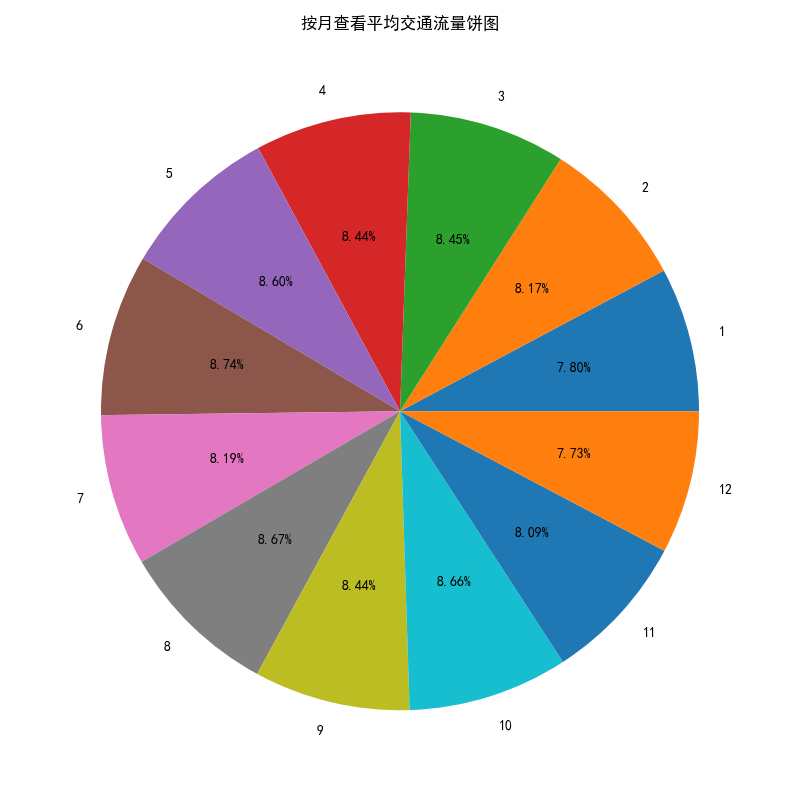
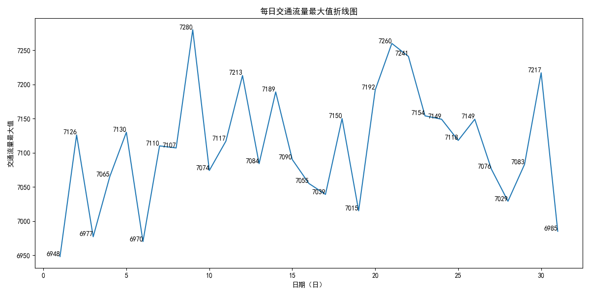
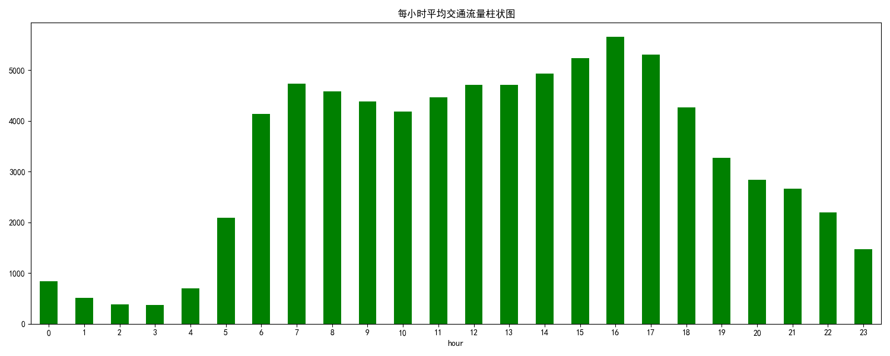
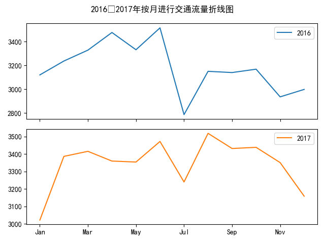
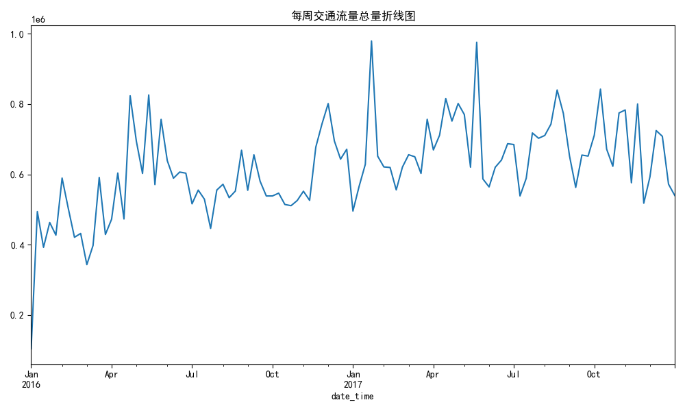
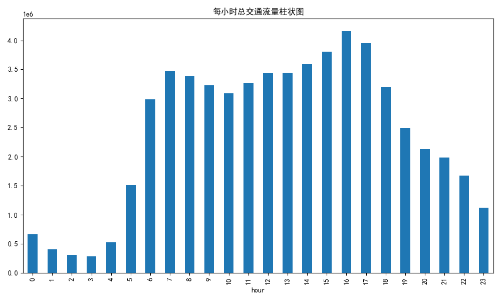

# 州际公路交通量时间序列分析
> 数据科学与大数据技术｜Pandas时间序列实战项目
完成时间序列读取、时间类型转换、索引处理、重采样resample、时间切片、分组统计与时序可视化。

## 数据集说明
- date_time：时间时间戳
- traffic_volume：州际公路交通流量

## 技术栈
Python Pandas、Matplotlib
核心API：pd.to_datetime、set_index、resample降采样/升采样、truncate时间切片、groupby时间维度分组、ffill缺失填充

## 分析流程
3.1 州际公路交通量数据集介绍
3.2 数据读取
3.3 创建时间类型数据
3.4 查看时间跨度
3.5 groupby降采样到年份、月份
3.6 groupby降采样到每天、每小时
3.7 划分出2016年至2017年数据
3.8 2016至2017年每月平均交通流量对比分析
3.9 每周交通总量分析
3.10 升采样到每小时查看平均交通流量分布
## 📊 可视化结果预览














## 运行依赖
```bash
pip install pandas matplotlib
